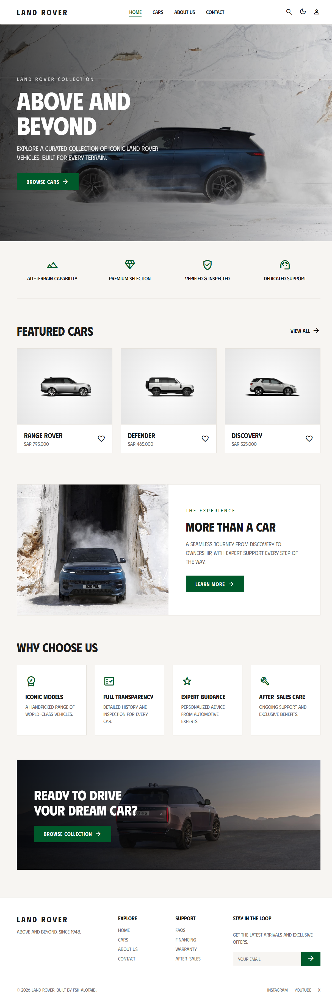
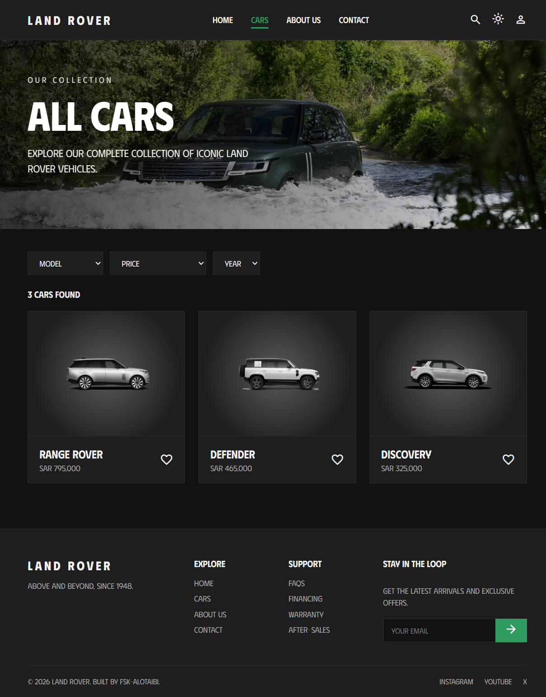
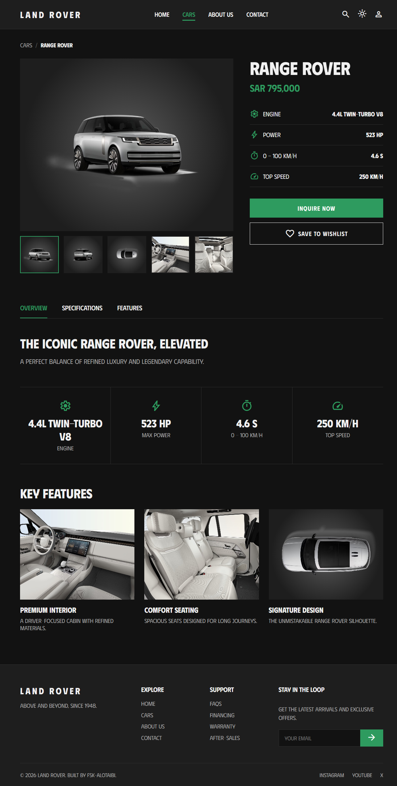
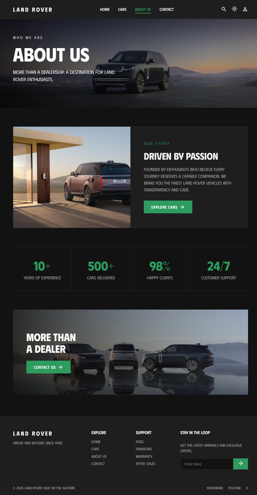
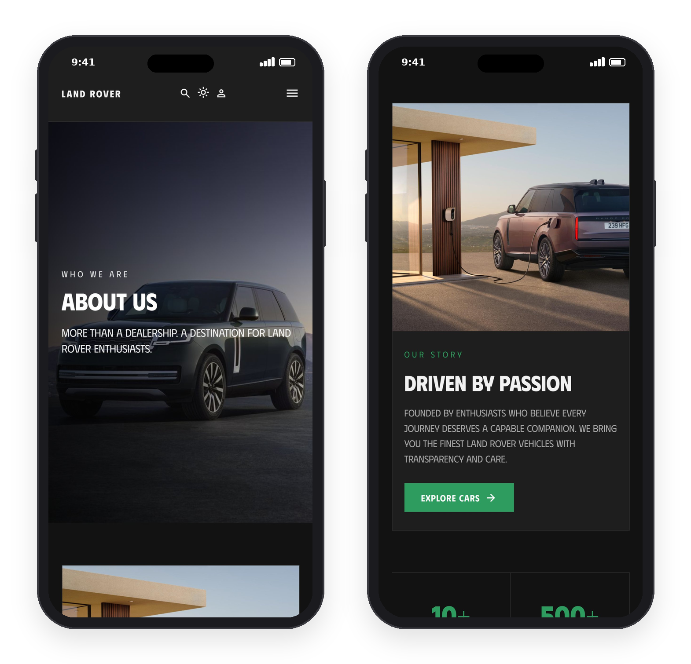

# Land Rover Dealership Website

A multi-page dealership website for Land Rover vehicles, built with **Django** templates,
**CSS**.



## Features

- **Template inheritance:** one `base.html` with the navbar and footer, extended by every page.
- **One template for all car pages:** `car_detail.html` renders Range Rover, Defender and Discovery from data passed by each view.
- **Dark mode without JavaScript:** a Django view saves the theme in a cookie, and CSS variables switch the colors.
- **CSS-only image gallery:** click a thumbnail to show it in the main viewer (radio buttons + `:checked`).
- **Animations and transitions:** fade-up hero, 3D tilt on the main car image, hover effects on cards and buttons.
- **Responsive design:** tablet and mobile layouts, with a CSS-only hamburger menu.
- **Optimized images:** a Pillow script compressed the page images from ~123 MB to ~1.4 MB.

## Pages

| Page | URL |
|---|---|
| Home | `/` |
| All Cars | `/cars/` |
| Range Rover | `/cars/range-rover/` |
| Defender | `/cars/defender/` |
| Discovery | `/cars/discovery/` |
| About Us | `/about/` |

## Screenshots

| All Cars | Car Detail |
|---|---|
|  |  |

| About Us |
|---|
|  |

### Mobile



## Tech Stack

- Python 3.10, Django 5.2
- HTML, CSS
- Google Fonts (`Phudu`) and Material Symbols icons
- Pillow (image compression script)

## Run Locally

```bash
git clone https://github.com/JZL9/LAB-SPORTS-CARS.git
cd LAB-SPORTS-CARS
python -m venv venv
venv\Scripts\activate
pip install -r requirements.txt
cd LandRover
python manage.py runserver
```

Then open `http://127.0.0.1:8000/`.

## Lab Requirements

Built for the **LAB-SPORTS-CARS** assignment (Tuwaiq Academy Python bootcamp):
templates and inheritance, Google Fonts and icons, static files, dark mode,
CSS transitions and animations, responsive layout, and the required pages.

## Credits

Vehicle images are from the official [Land Rover Media](https://media.landrover.com) press site,
used for educational purposes only. This project is not affiliated with Land Rover.

---

Built by **Fahad Al-Otaibi**