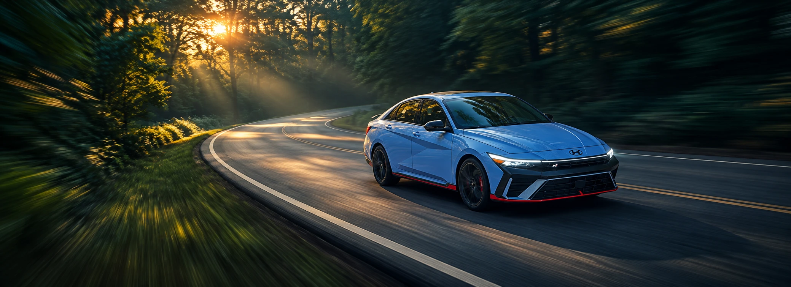

# LAB-SPORTS-CARS

## Create a website for a sports cars dealership (SportsCars) , the website should have a home page that looks like the image below , you should :
- use templates & templates inheritance.
- use google fonts (choose the same font `Phudu` , or a similar one) [https://fonts.google.com](https://fonts.google.com)
- use google fonts icons (choose similar icons) [https://fonts.google.com/icons](https://fonts.google.com/icons)
- use images and icons of your chosing (not necessarily like the below image, You can find image in the resources folder).
- use static for your static files (css, images, videos, etc.)
- use icons of your choosing (not necessarily like the below image)
- Implement dark mode.
- Use CSS Transitions and Animations to add vitality to your page.
- Use fake urls for links, or demo links (real links for example to instagram online car dealer)
- It should be responsive (looks good on desktop & mobile)
- you can use css libraries like (bootstrap, tailwinds, etc.) along with your own css. 

## Required Pages:
- 1 Home page
- 3 Cars Detail Page.
- 1 All Cars Page.
- 1 About us page

### UX/UI Screens

